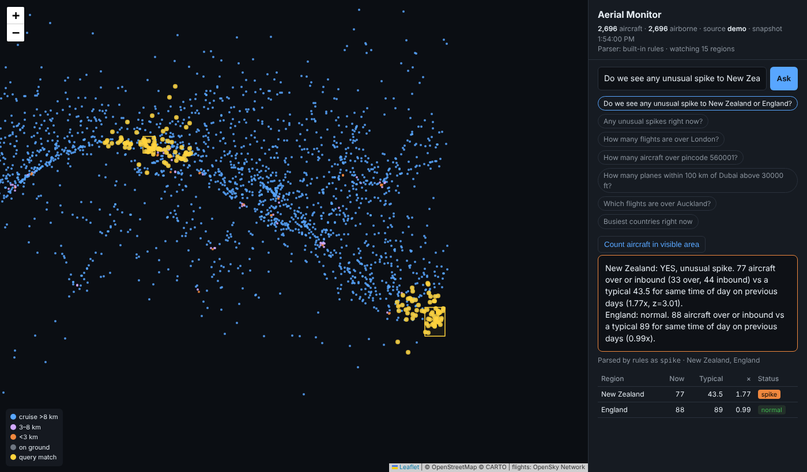

# Aerial Monitor

Live world flight map plus a plain-English query engine:

- "Do we see any unusual spike to New Zealand or England?"
- "Any unusual spikes right now?"
- "How many flights are over London?" / "...over pincode 560001?" / "...within 100 km of Dubai above 30000 ft?"
- "Which flights are over Auckland?" / "Busiest countries right now"



## Architecture

```
 adsb.lol (default) ──► Collector (every N s) ──► in-memory snapshot ──► /api/states ──► Leaflet map
   (or OpenSky / Demo)         │                                                    ▲
                               └─► per-region counts ─► SQLite ◄─ baselines ─┐      │
 Question ─► Parser (Claude or rules) ─► QueryIntent ─► Executor ────────────┴──► /api/query
                                                        │
                       Nominatim (OSM) geocoder ◄───────┘  country/city polygons, postcodes → circle
```

| Piece | File | Notes |
|---|---|---|
| Data source | `app/sources.py` | **adsb.lol** (default): free, keyless, ODbL. Worldwide picture = union of its global per-aircraft-type endpoint over ~50 airliner types; small areas (≤250 nm) also merge its point query, which includes GA and helicopters. **OpenSky** (`AM_SOURCE=opensky`) gives all transponder traffic but is rate limited and times out from Vercel/AWS. `demo` generates synthetic traffic (incl. an injected New Zealand spike) for offline use. |
| Geocoding | `app/geo.py` | **Nominatim** returns boundary polygons for countries/cities/areas; postcodes and Indian PIN codes come back as points, so they become a circle (default 10 km). Cached in SQLite. Small built-in gazetteer as offline fallback. |
| Collector | `app/monitor.py` | Polls the source, records "aircraft over" and "aircraft inbound" counts for every watched region. Any place you ask about joins the watchlist automatically. |
| Spike detection | `app/monitor.py` `spike()` | Current (over + inbound) vs median of the same time of day on previous days (falls back to last 24 h). Robust z-score (MAD) ≥ 3 **and** ≥ 1.25× median. |
| "Flights to X" | `app/geo.py` `is_inbound()` | State vectors carry no destination, so "inbound" = airborne, outside the region, and its current track at current speed enters the region within 2 h. A heuristic proxy; see *Next steps*. |
| Query engine | `app/query.py` | Question → `QueryIntent` (count / list / spike / spike_scan / busiest / overview, places, altitude filters). Uses Claude (structured output) when an API key is set, else a regex parser. |
| API + UI | `app/main.py`, `static/index.html` | FastAPI; single-page Leaflet map with canvas rendering for ~10k aircraft. |

## Run it

```bash
python -m venv .venv && source .venv/bin/activate
pip install -r requirements.txt

# Offline demo (synthetic flights, 7 days of backfilled history, a spike into Auckland):
AM_SOURCE=demo uvicorn app.main:app --port 8000

# Live data:
uvicorn app.main:app --port 8000
```
Open http://localhost:8000.

### Live data settings (env vars)

| Var | Default | Meaning |
|---|---|---|
| `AM_SOURCE` | `adsblol` | `adsblol`, `opensky`, or `demo`. |
| `OPENSKY_CLIENT_ID` / `OPENSKY_CLIENT_SECRET` | unset | Only for `AM_SOURCE=opensky`. Anonymous access allows ~100 global snapshots/day. |
| `AM_POLL_SECONDS` | 120 (900 for anonymous OpenSky) | Snapshot interval. |
| `AM_WATCHLIST` | NZ, England, UK, India, US, … | Comma list of places tracked from startup. |
| `AM_SPIKE_Z`, `AM_SPIKE_RATIO`, `AM_MIN_BASELINE` | 3.0, 1.25, 6 | Spike sensitivity. |
| `ANTHROPIC_API_KEY` (+ `AM_LLM=1`) | unset | Use Claude to parse questions (handles typos and odd phrasing better). |
| `AM_DB` | `aerial_monitor.sqlite3` | History + geocode cache. |

Spike answers need history: with live data, give it a day or two of polling for "same time of day" baselines (it uses the last 24 h until then).

## Deploy on Vercel

The repo is Vercel-ready (`vercel.json` routes everything to `api/index.py`). On Vercel there's no
long-running poller, so the app switches to serverless mode automatically:

- A flight snapshot is fetched on demand and reused for `AM_SNAPSHOT_TTL` seconds (default 90).
- Region counts for spike baselines are recorded at most every `AM_RECORD_INTERVAL` (600 s), on page traffic or on `POST /api/collect`.
- If the live source fails, the map shows demo data with a clear "DEMO" banner instead of going blank; demo numbers are never written to history.

Steps:
1. vercel.com → **Add New → Project → Import** `satishRajooru/AerialView`. Framework preset: *Other*. Deploy.
2. **Storage → Upstash Redis** (free tier) → connect to the project. This adds `KV_REST_API_URL` / `KV_REST_API_TOKEN`; without it spike history resets on every cold start.
3. Environment variables (optional): `ANTHROPIC_API_KEY`, `AM_COLLECT_TOKEN` (any random string). Redeploy.
4. GitHub → repo **Settings → Secrets and variables → Actions**: add variable `AERIAL_URL` = your Vercel URL, and secret `AM_COLLECT_TOKEN` (same value). `.github/workflows/collect.yml` then records a snapshot every 15 minutes, so baselines build even with no visitors (Vercel Hobby crons only run daily).

## Tests

```bash
pip install -r requirements-dev.txt
pytest -q
```

## Known limits / next steps

1. **Inbound is dead-reckoned.** For true "flights to New Zealand", add OpenSky `/flights/arrival?airport=NZAA` (authenticated, batch, previous day) or a route DB (callsign → origin/destination) and compare arrivals by day.
2. **Coverage.** The worldwide view counts airliners only (by type); small areas include everything. Community ADS-B coverage is thin over oceans and parts of Africa/Asia. ADS-B Exchange (paid via RapidAPI) or airplanes.live / adsb.lol (regional, 250 nm radius) can be added as extra sources in `sources.py`.
3. **Single process, SQLite.** Fine for one user. For scale: TimescaleDB/ClickHouse for counts, Redis for the latest snapshot, a separate collector worker.
4. **Polygons are simplified** to ≤400 points per ring for speed; borders are approximate to a few km.
